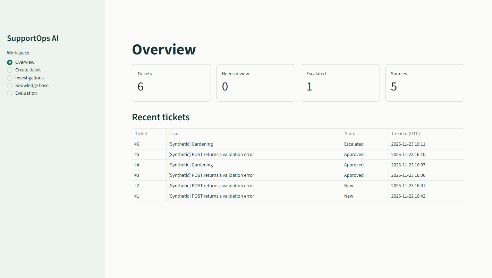
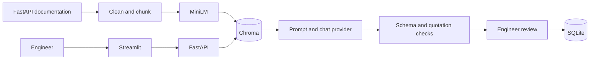

# SupportOps AI

An evidence-grounded investigation desk for FastAPI support tickets. An engineer submits a redacted issue, inspects relevant documentation, reviews a model-generated draft and records the final decision. Every proposed step must cite a retrieved chunk and include a quotation the backend can verify.

## Run locally on Windows

**Prepared workspace.** If the virtual environment, CPU server, and model already exist under this checkout, run `.\scripts\start_local.ps1` from the repository root and open [the dashboard](http://127.0.0.1:8501). The script starts the model, API, and UI together. Ctrl+C stops the stack. For a fresh clone or ZIP, use the setup below.

Install Python 3.11 or 3.12, [uv](https://docs.astral.sh/uv/getting-started/installation/) and, for the default chat provider, [Ollama](https://ollama.com/download). Start the Ollama service. The first install and model pulls require internet access and several GB of free disk. CPU inference works with small models. In PowerShell, from the extracted repository root:

```powershell
uv sync --frozen --python 3.11
uv run python -m scripts.bootstrap
ollama pull qwen2.5:3b
uv run uvicorn backend.main:create_app --factory --host 127.0.0.1 --port 8000
```

Bootstrap generates an administrator key in the local `.env`. The API creates its SQLite database on startup. In a second PowerShell window from the same directory:

```powershell
uv run python -m scripts.operator ingest
uv run python -m scripts.operator seed
uv run streamlit run frontend/app.py --server.address=127.0.0.1
```

Open [the desk](http://127.0.0.1:8501) and choose **Investigations**. Select a synthetic ticket and **Run investigation**. Expand the sources, inspect the reply, edit it and save a review. For admin screens use the key from your local `.env`. The same uv commands work in a POSIX shell. Swagger UI is available at [API docs](http://127.0.0.1:8000/docs).

## Workflow and implementation





- **Knowledge base.** Synchronize authorized sources, inspect per-source job outcomes, search sections and retire documents. Content-addressed revisions keep incomplete replacements out of retrieval.
- **Investigations.** Pydantic validates the model response. The server resolves citations against the retrieval snapshot. An unsupported draft requests more information and can be escalated. Earlier drafts remain inspectable after updates.
- **Review.** Review decisions, edited replies and usefulness feedback are persisted independently of model output. The latest pending analysis owns the review transition.
- **Evaluation.** A reproducible runner compares dense retrieval and source diversity. Both ranked the expected document first on eight labeled queries over five official sources. This small result measures document retrieval. It provides limited evidence about troubleshooting quality. [Method and raw results](docs/evaluation.md)

| Directory | Contents |
|---|---|
| backend/ | Request contracts, API, SQLite transactions, source loaders, chunking, embeddings, retrieval and generation |
| frontend/ | Five Streamlit views and HTTP integration |
| scripts/ | Bootstrap, operator CLI, model cache, benchmark and live checks |
| data/ | Synthetic tickets and evaluation cases |
| docs/ | Architecture, deployment, evaluation and validation evidence |
| tests/ | Offline workflow and failure-path tests |
| runtime/ | Generated database, model cache, vector index and optional authorized inbox, excluded from Git |

## Model and environment settings

| Setting | Purpose |
|---|---|
| DATA_DIR | Writable persistent directory, default runtime |
| ADMIN_KEY | Required for sync, removal, job inspection and evaluation |
| PROVIDER / CHAT_MODEL | ollama, llamacpp or openai and a model served by that provider |
| OLLAMA_URL / LLAMA_URL | Local chat server addresses, default localhost ports 11434 and 8080 |
| OPENAI_API_KEY | Hosted-provider credential, only required for openai |
| PROVIDER_TIMEOUT / TEMPERATURE | Timeout in seconds per request and sampling temperature |
| EMBEDDING_MODEL / EMBEDDING_REVISION | Pinned MiniLM identity. Use a fresh index for a different encoder. |
| CHUNK_WORDS / OVERLAP_WORDS | Word-window size and overlap, default 130 and 24 |
| API_URL | API address read from the Streamlit process environment |

For hosted inference, set PROVIDER=openai, OPENAI_API_KEY and a chat-completions-compatible CHAT_MODEL in .env, then restart the API. Hosted requests transmit the redacted ticket and excerpts. The free local alternative used for validation is llama.cpp serving a quantized Qwen2.5-1.5B-Instruct model. Set PROVIDER=llamacpp, CHAT_MODEL to the served name, and LLAMA_URL to the local server. The model loader is independent of the chat adapter. Mock inference is available only through test dependency injection.

## Checks and deployment

The Windows release check passed 18 software tests. The local model made the expected sufficiency decision on four of five controlled cases. It missed a source conflict and gave an incorrect diagnostic step in a path-parameter case. The desk preserves the draft and its evidence so the engineer can reject or correct it. [Evaluation report](docs/evaluation.md)

```powershell
uv run pytest -q
uv run ruff check backend scripts frontend tests
uv run python -m scripts.operator evaluate
```

For a containerized setup, generate .env and run `docker compose up --build -d`. The API and UI use an internal service hostname and a persistent volume. [Deployment guide](docs/deployment.md)

## Project documentation

[Architecture and diagrams](docs/architecture.md) · [Requirements and verification](docs/requirements.md) · [API reference](docs/api.md) · [Data sources and licenses](docs/data_sources.md) · [Design decisions](docs/design_decisions.md) · [Security](docs/security.md) · [Troubleshooting](docs/troubleshooting.md) · [Product demo](docs/demo_script.md)

The application targets a trusted local support desk. Before a shared deployment, add authenticated engineer identities, ticket-level access control, stronger sensitive-data handling and larger independently judged evaluation sets. Upstream documentation and model weights retain their own licenses. Project code is available under the [MIT license](LICENSE).
