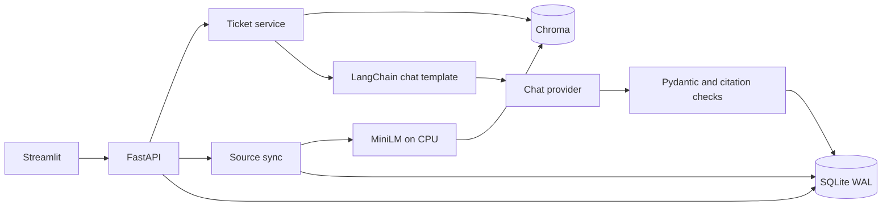
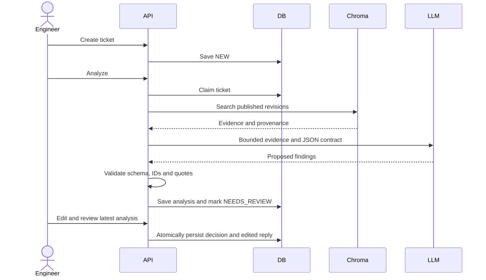
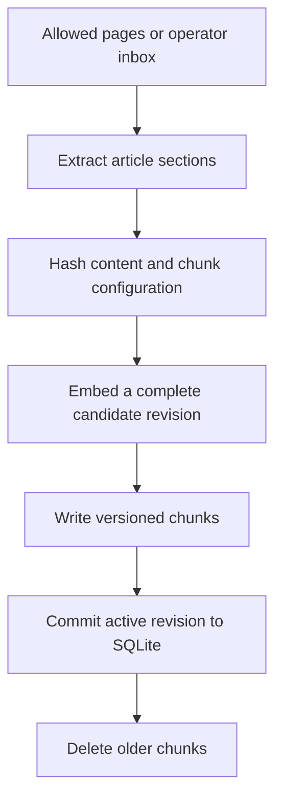
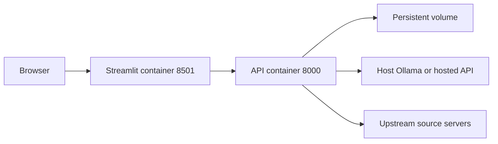

# Architecture

One process owns the index directory. SQLite reserves a ticket before inference and releases its write lock during model I/O. A concurrent review or analysis must win the expected-state update. The latest analysis ID prevents stale review submissions. The accepted edit and status change share a transaction. On startup, interrupted claims and ingestion jobs recover from persisted history. Index writes stage new chunks under their content revision. Retrieval filters against committed revision identifiers.
